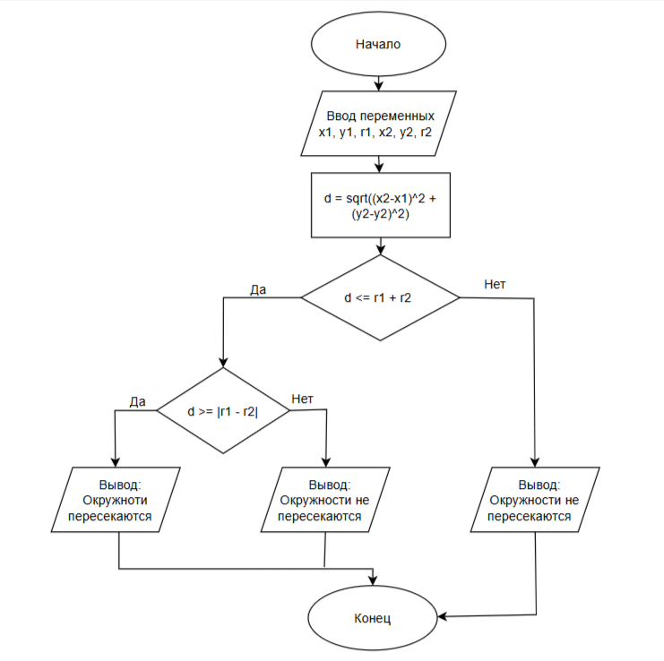

# Домашнее задание к работе 6

## Условие задачи
Две окружности заданы координатами своих центров и радиусами.
Определить, пересекаются ли они.
## 1. Алгоритм и блок-схема

### Алгоритм
  **Начало**
 - x1, y1 - координаты первой окружности
 - x2, y2 - координаты второй окружности
 - r1 - радиус первой окружности
 - r2 - радиус второй окружности
 - d - расстояние от 1-й окружности до 2-й 
 - d = квадратный корень из ((x2 - x1) * (x2 - x1) + (y2 - y1) * (y2 - y1))
 - если расстояние меньше либо равно сумме двух радиусов и расстояние больше либо равно модулю разности двух радиусов то вывод окружности пересекаются 
 - если нет то вывод окружности не пресекаются 
  **Конец**

### Блок-схема[

[https://github.com/uliases00/domashnaya-6/blob/main/dz6.png]


## 2. Реализация программы

```c
#define _CRT_SECURE_NO_WARNINGS
#include <locale.h>
#include <stdio.h>
#include <math.h>

int main()
{
	setlocale(LC_CTYPE, ".UTF-8");

	double x1, y1, r1;
	double x2, y2, r2;

	printf("Введите x1 и y1 первой окружности и радиус:\n");
	scanf("%lf %lf %lf", &x1, &y1, &r1);

	printf("Введите x2 и y2 второй окружности и радиус : \n");
	scanf("%lf %lf %lf", &x2, &y2, &r2);

	double d = sqrt((x2 - x1) * (x2 - x1) + (y2 - y1) * (y2 - y1));
	
	if (d <= r1 + r2 && d >= fabs(r1 - r2))
	{
		printf("Окружности пересекаются\n");
	}
	else
	{
		printf("Окружности не пересекаются\n");
	}
	return 0;
}
```

## 3. Результаты работы программы
```c
Введите x1 и y1 первой окружности и радиус:
4 0 6
Введите x2 и y2 второй окружности и радиус :
7 5 9
Окружности пересекаются
```
## 4. Информация о разработчике

Черкасова Ульяна бТИИ-261
