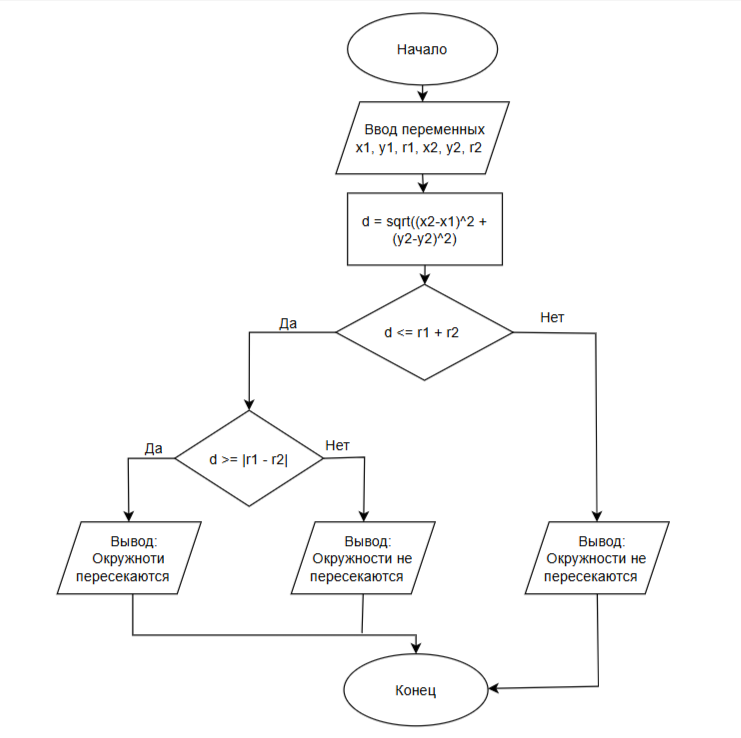

# Домашнее задание к работе 6

## Условие задачи
Две окружности заданы координатами своих центров и радиусами.
Определить, пересекаются ли они.
## 1. Алгоритм и блок-схема

### Алгоритм
  **Начало**
 
  **Конец**

### Блок-схема[

[https://github.com/uliases00/domashnaya-6/blob/main/dz6.png]


## 2. Реализация программы

```c

```

## 3. Результаты работы программы


## 4. Информация о разработчике

Черкасова Ульяна бТИИ-261
